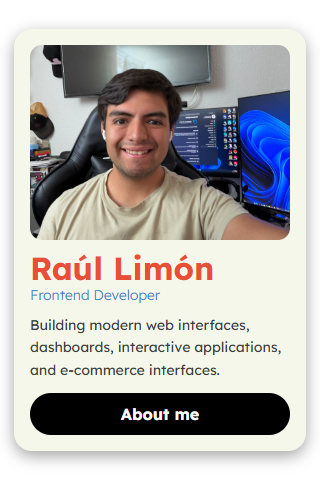
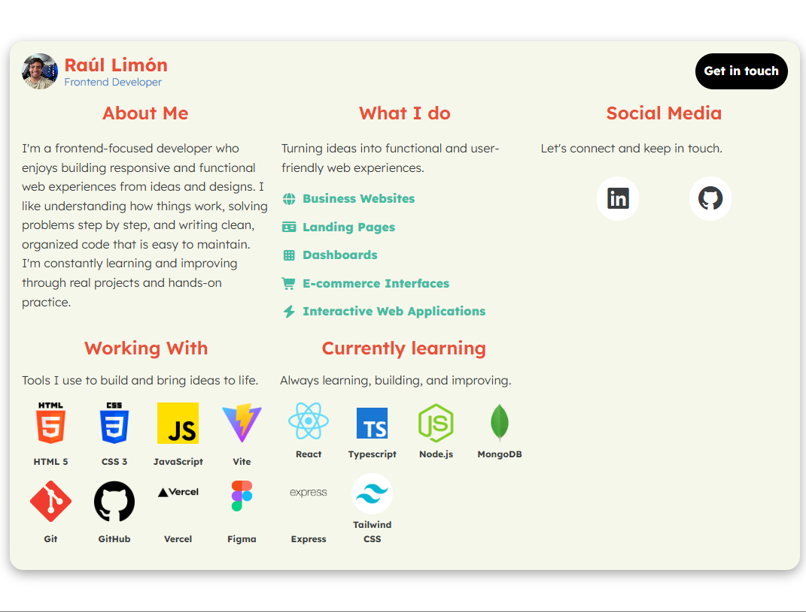
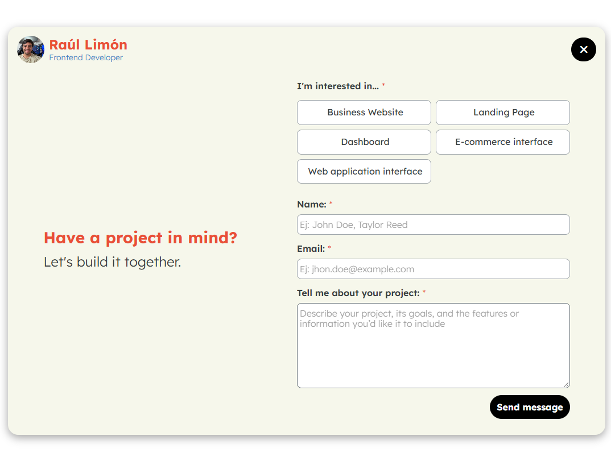
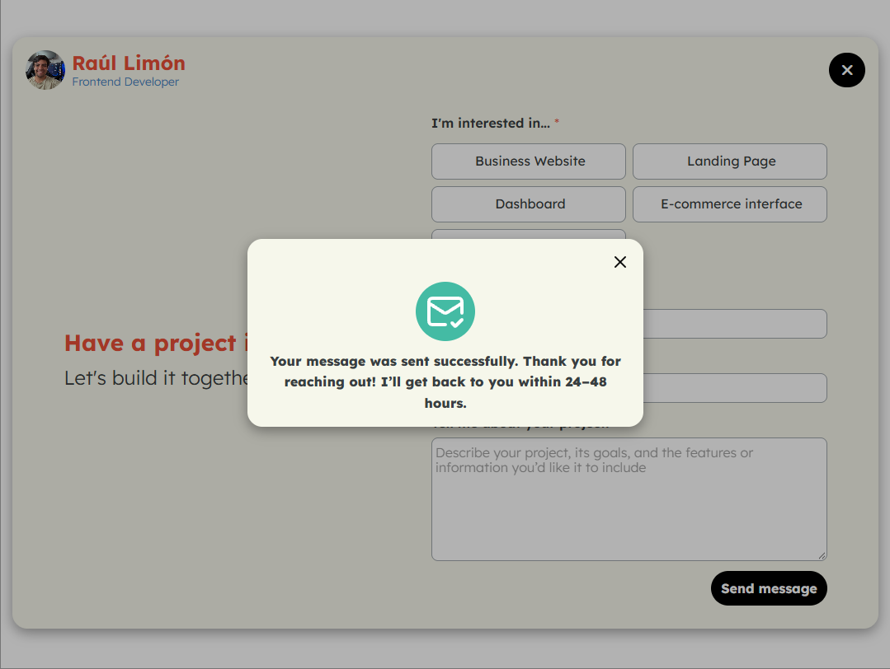

# Profile Card 🪪

A responsive profile card and contact page built with **HTML5**, **CSS3**, and **JavaScript**. It showcases profile information and lets visitors send project inquiries through a validated contact form.

---

## 🚀 Live Demo

🔗  [Profile card](https://raullimon3.github.io/Profile-Card/)

---

## 📸 Screenshots






---

## 📌 Features

- Responsive profile card with interactive views
- Project inquiry form with client-side validation
- Asynchronous form submission using Formspree
- Loading state to prevent duplicate submissions
- Success and error feedback in a modal
- CSS organized by layout, sections, components, and utilities
- JavaScript organized into ES modules

---

## 🛠️ Built With

- HTML5
- CSS3
- JavaScript (ES modules, Fetch API)
- Formspree
- Google Fonts
- Font Awesome
- Git & GitHub

---

## 📂 Project Structure

```
01-profile-card/
├── index.html
├── css/
│   ├── base/
│   ├── components/
│   ├── layout/
│   ├── sections/
│   ├── utils/
│   └── style.css
├── js/
│   ├── api.js
│   ├── form.js
│   ├── main.js
│   ├── modal.js
│   └── validation.js
├── public/
│   └── img/
├── screenshots/
│   ├── mobile-profile.png
│   ├── desktop-about.png
│   ├── contact-form.png
│   └── submission-statuses.png
└── README.md
```

---

## 🧪 Versioning

This project follows a simple versioning system:

| Version | Description |
|--------|-------------|
| v1.0 | Responsive profile card with the initial layout and profile content |
| v2.0 | Interactive profile views, modular JavaScript, contact form validation, and asynchronous Formspree submission with success and error feedback |
| Next | Continue improving accessibility and testing across devices and form states |

---

## 📈 Learning Goals

This project was created to practice:

- Structuring a page with semantic HTML
- Building responsive layouts with CSS and media queries
- Organizing styles into reusable component files
- Using JavaScript modules to separate application responsibilities
- Handling DOM events and interactive UI states
- Validating form inputs and displaying field-level feedback
- Sending form data asynchronously with the Fetch API
- Handling loading, success, and error states
- Integrating a third-party form service with Formspree
- Using Git branches and commits to track development

The project is still evolving, with responsive behavior, accessibility, and testing improvements planned.

---

## 👤 Author

Developed by **Raúl Limón**  
Frontend Developer focused on building scalable and maintainable web applications while continuously improving JavaScript and frontend architecture skills.

- GitHub: [RaulLimon3](https://github.com/RaulLimon3)  
- LinkedIn: [Raúl Limón]https://www.linkedin.com/in/raul-limon-garcia/

---

## 📄 License

This project is open source and available for learning and portfolio purposes.

---

## 🧩 Development Stages

The v1.0 release was built in three internal stages:

- v1: Base HTML structure
- v2: Visual styling and UI design
- v3: Responsive layout
